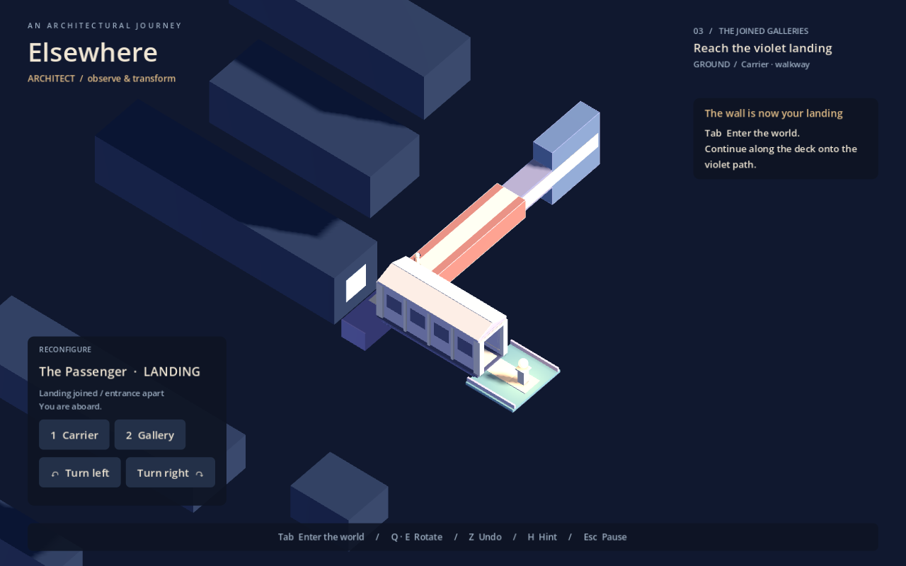

# Elsewhere

A playable Godot prototype about arranging architecture, choosing where to stand, and walking through impossible connections.

**The current revision uses authored paths.** Ordinary edges stop the character. Walls and undersides are not freely walkable. Board the terracotta deck, then rotate it to carry your ground onto the vertical landing. Ivory paving marks the walkable route.

**The architectural camera stays above the traveller's current ground.** It rolls with the surface and arcs overhead when a turn requires changing sides. Full modules appear by default; hover over a gallery or enter it to reveal its interior. Moving away restores the full model. Traversal remains enclosed.

Align the turning gallery with its counterpart, then walk through it in third person. A concealed, two-way portal implements the spatial connection inside matching architecture. Settled overview views preserve the endpoint alignment.

Open **project.godot** in Godot 4.6 and press **F5**.

| Action | Default |
|---|---|
| Walk / orbit | WASD / mouse |
| Architectural / traversal view | Tab |
| Select carrier / gallery | 1 / 2, or click in overview |
| Quarter-turn the selected structure | Q / E |
| Undo / recover checkpoint | Z / R |
| Escalating hint / settings | H / Escape |

Third person is the default. Settings provide first person, camera distance, sensitivity, reduced motion, optional world horizon, remapping and optional contextual guidance.

The earlier free-surface layout has been replaced. Save version 3 starts older checkpoints at the revised entrance; settings remain compatible. The previous workstation save was backed up before this revision.

- [Current specification, decisions and limitations](docs/spec.md)
- [Project development guide](docs/skill.md)
- [Verification and screenshots](docs/validation.md)
- [Short playtest checklist](docs/playtest.md)
- [Original concept, preserved unchanged](docs/original-concept.md)

Gameplay uses procedural geometry and sound. No external assets or addons are required in a fresh clone. This is one compact puzzle, not the full proposed campaign. Godot MCP Pro 1.17.1 is used locally for development; the proprietary addon, credentials and machine-specific integration are excluded from Git.
