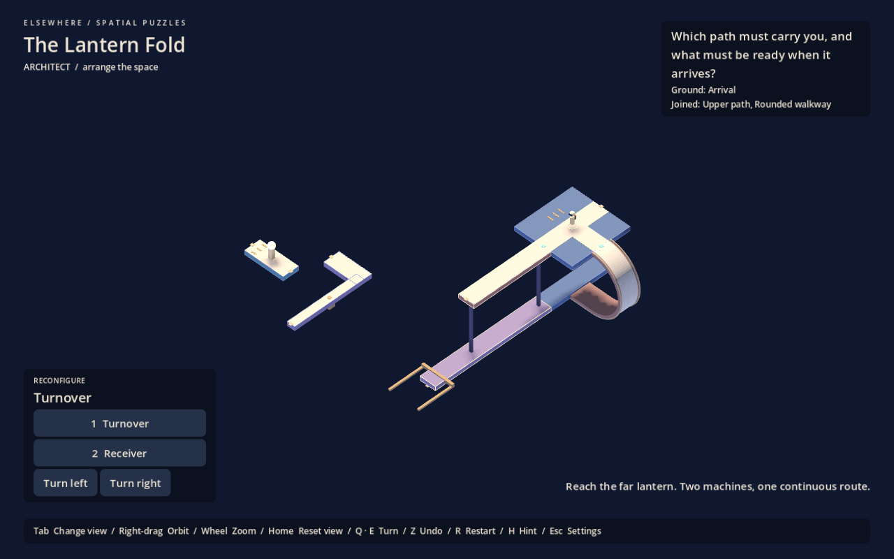

# Elsewhere

**Where do I need to be before I transform the space?**

**The Lantern Fold** is a complete prototype puzzle with one continuous route, two interacting machines, an underside approach and a final lantern. Choose the path that must carry you and prepare the receiving walkway before the docking arms occupy its turning clearance. H offers optional hints; Z and R let you recover or restart.

The three original studies remain separately playable:

1. **Choose your deck:** reach the right walking path before rolling the carrier.
2. **The quiet landing:** step off onto fixed ground so an empty carrier can bring a different path to you.
3. **Prepare the receiver:** arrange the receiver before docking arms occupy its turning clearance.

Impossible geometry is optional. The original gallery experiment is available separately from the menu, with its own saved progress.

Open **project.godot** in Godot 4.6 and press **F5**. A new save opens The Lantern Fold; existing saves resume their active puzzle. Escape opens the complete puzzle, all three studies, and settings. Ordinary edges stop movement; only marked curves change gravity while walking.

| Action | Default |
|---|---|
| Walk / look | WASD / mouse |
| Architectural / traversal | Tab |
| Select structure | 1 / 2 |
| Rotate | Q / E |
| Undo / restart study | Z / R |
| Hint / studies and settings | H / Escape |
| Orbit overview / zoom | Right mouse drag / wheel |
| Reset overview framing | Home |

First person is the default traversal view, with movement and look following the occupied surface. Isometric view stays above the current ground to help you reorient and transform the architecture. The experimental third-person modes remain available in settings.

Isometric view follows changes in the ground direction, the behavior selected after the A/B playtest. A horizontal turntable carries the character without orbiting the camera; tilts and curved ground carry the camera with them. Manual orbit is separate, with bounded elevation and zoom; Tab preserves the chosen view. [Camera decision and comparison history](docs/isometric-camera-experiment.md).

- [Complete puzzle layout and solution](docs/lantern-fold.md)

- [Current specification](docs/spec.md)
- [Development guide](docs/skill.md)
- [Verification and visual evidence](docs/validation.md)
- [Reasoning playtest](docs/playtest.md)
- [Optional gallery experiment](docs/gallery-study.md)
- [Original concept, preserved](docs/original-concept.md)

Godot MCP Pro 1.17.1 is used locally for development. The proprietary addon, credentials and machine-specific configuration are excluded from Git; no addon is required to play a fresh clone.
