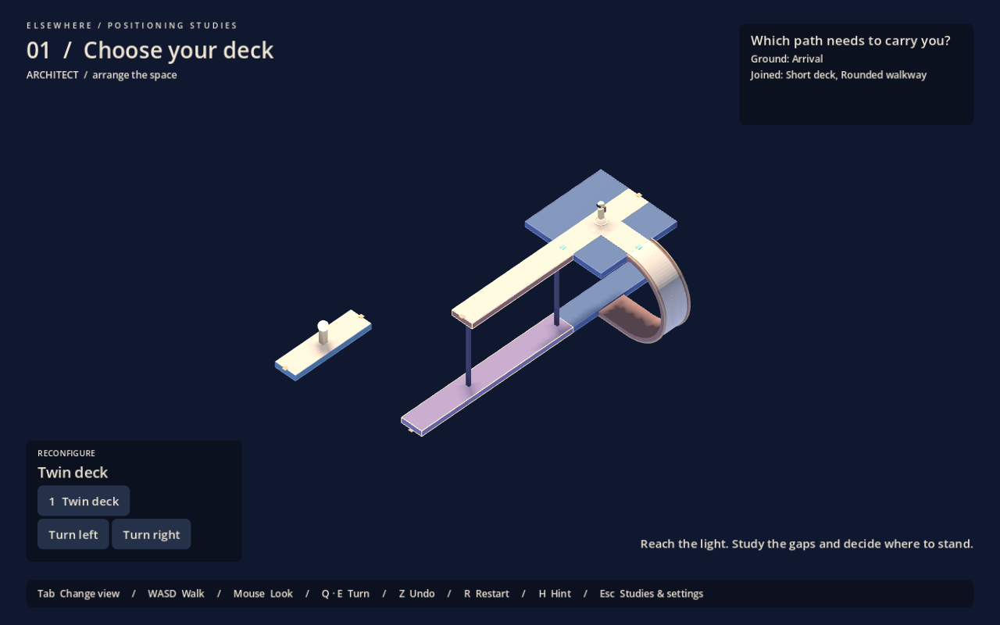

# Elsewhere

**Where do I need to be before I transform the space?**

Three small Godot puzzles test player positioning and action order using physical paths, curved gravity transitions and moving structures:

1. **Choose your deck:** reach the right walking path before rolling the carrier.
2. **The quiet landing:** step off onto fixed ground so an empty carrier can bring a different path to you.
3. **Prepare the receiver:** arrange the receiver before docking arms occupy its turning clearance.

Impossible geometry is optional. The original gallery experiment is available separately from the menu, with its own saved progress.

Open **project.godot** in Godot 4.6 and press **F5**. Escape selects a study or opens settings. Ordinary edges stop movement; only marked curves change gravity while walking.

| Action | Default |
|---|---|
| Walk / look | WASD / mouse |
| Architectural / traversal | Tab |
| Select structure | 1 / 2 |
| Rotate | Q / E |
| Undo / restart study | Z / R |
| Hint / studies and settings | H / Escape |

Third person now keeps the screen aligned to the world, allowing the character to appear upside down. Isometric view stays above their current ground to help you reorient. Surface-following third person and optional first person remain available in settings.

- [Current specification](docs/spec.md)
- [Development guide](docs/skill.md)
- [Verification and visual evidence](docs/validation.md)
- [Reasoning playtest](docs/playtest.md)
- [Optional gallery experiment](docs/gallery-study.md)
- [Original concept, preserved](docs/original-concept.md)

Godot MCP Pro 1.17.1 is used locally for development. The proprietary addon, credentials and machine-specific configuration are excluded from Git; no addon is required to play a fresh clone.
