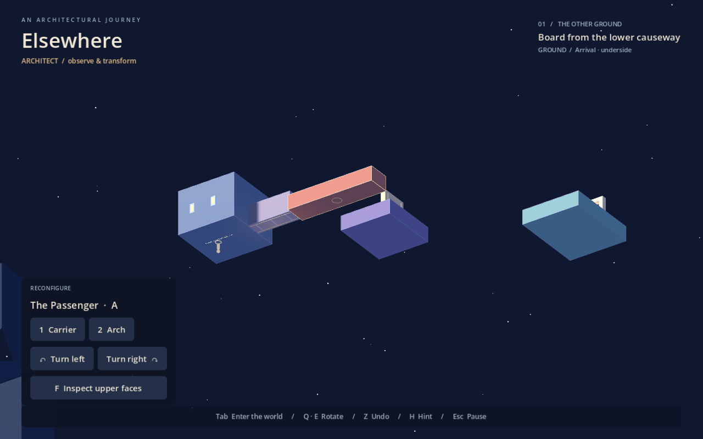

# Elsewhere

A playable Godot prototype of the supplied spatial puzzle adventure concept.

**Third person is the default traversal camera**, with a visible character and an orbit that follows the supporting surface. Edge turns ease the camera into the new frame, keeping the character upright and the view attached. Mouse movement orbits the camera. Escape → Traversal camera lets you choose first person; the same menu adjusts follow distance, reduced motion, and an optional fixed world horizon. Held movement continues around edges; releasing/changing direction makes the next movement screen-relative.

Open **project.godot** in Godot 4.6 and press **F5**. Starts in architectural view. Press **Tab** to enter the world; walk with **WASD**, look with the mouse. In overview, **F** inspects the upper/lower faces. Select the carrier or arch with **1 / 2** or a click, and rotate with **Q / E**. **Z** undoes a transformation, **R** restores the checkpoint, **H** gives a hint, and **Escape** opens settings.

Begin with **The Other Ground**: walk around an exposed arrival edge and discover the underside causeway. Board the carrier from below before turning it. Reach the violet courtyard, wrap back onto its top, align the arch, and walk through to the distant light. Every exposed face of the main blocks is walkable; solid internal joins cannot be walked through.

- [Game specification and full feature status](docs/spec.md)
- [Project development guide / skill.md](docs/skill.md)
- [Unabridged source concept](docs/original-concept.md)

Gameplay uses procedural geometry and sound; no external assets or addons are required to run a fresh clone. This is one compact courtyard prototype, not the full proposed campaign.

Godot MCP Pro 1.17.1 was used for development and validation. Its proprietary addon and machine-specific configuration are excluded from this repository. If you own MCP Pro, install it locally under `addons/godot_mcp/`; keep its autoload/plugin settings in the ignored `override.cfg`. See [the development guide](docs/skill.md) for connection details.
