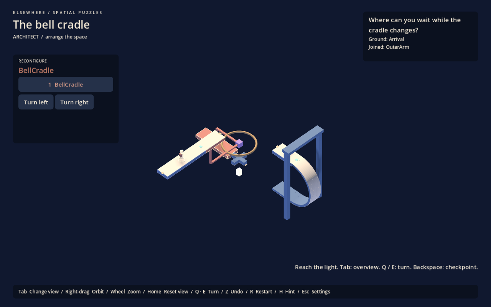

# Elsewhere level authoring

Implemented Phase 0/1 foundation, 1 October 2026. The complete [user proposal](level-authoring-proposal.md) is preserved separately. This is a scene-authoring workflow inside Godot, not a production or player-facing level editor.

## Start here

1. Reload the project, then open `scenes/authored/turning_frame.tscn`. The **Elsewhere Authoring** plugin is enabled in the project. If the dock is absent, enable it under Project Settings > Plugins. Local overrides must include it too.
2. Expand **Level** in the Scene tree. Select a path, curved transition, structure or marker and edit its data in the Inspector. These are real saved scene nodes; the old procedural puzzles remain separate.
3. Use **Refresh preview and validate** in the Elsewhere dock. Its preview shows the authored initial states, while the main editing viewport shows the base pose used to position children.
4. Choose a structure state in the dock. This changes an isolated preview copy; it does not rotate, save or dirty the authored nodes. Green contacts are joined, amber are open, red are invalid/inactive; blue lines show ground normals and gold lines show travel direction.
5. Select an active path, PlayerStart or Checkpoint, then press **Play From Selected Path / Marker**. It saves the scene, applies the preview states and starts at that location with matching gravity. Normal progress is neither loaded nor written during this debug launch. A later normal F6 runs normally. Path selection uses its centre (or the beginning of a curve); use a marker for an exact position.
6. F6 runs the authored scene from its normal start/save. In the running game's Escape menu, the three authored examples are also available.

For a new level, duplicate one of the authored scenes, change **Level > level_id** to a unique stable identifier, and edit the composition. Increment **revision** when changes invalidate saved contacts or state indices. Give it its own title, question, explanation and optional hints. No new gameplay script or hardcoded layout index is needed. F6 can play an unlisted scene; menu curation remains manual.

## Example monuments

| Scene | Spatial decision | Authoring coverage |
|---|---|---|
| `turning_frame.tscn` | Choose the longer passage before the roll; aligning from the wrong path is insufficient | Authored conversion of the existing monument, separate passages, 180° curve, passenger rotation |
| `bell_cradle.tscn` | Leave the moving arm at the fixed belfry before turning it again | Vertical belfry, radial cradle, checkpoint, fixed gravity transfer and a custom torus mesh independent of path logic |
| `folded_observatory.tscn` | Prepare the receiver before docking fingers occupy its sweep | Folding gallery, narrow bent receiver, two-state hinge, custom rectangular walk regions and collision boxes |

These are playable blockouts using three proven positioning dependencies, not three claims of new puzzle mechanics or finished architecture. Their solutions and important counterexamples are tested. Their visual identity, difficulty and human comprehension remain design work.



Also see the [folded observatory blockout](authoring-observatory.png) and the [isolated editor state preview](authoring-state-preview.png).

## Components and coordinates

Drag the small scenes in `scenes/authoring_components/` into a level, or add an `ElsewhereComponent` and select its **kind**. Inspector fields are filtered by kind. Paths, art and sockets inherit the transform of their parent structure; a rotating component's origin is its pivot.

| Component | Data and use |
|---|---|
| WalkablePath | Local Y=0 is the walking plane, +Y is ground normal, X is the default travel axis. Dimensions X/Z define length/width; Y is thickness below the plane. Optional Rect2 regions describe connected orthogonal passages. Ordinary edges block. |
| GravityCurve90 / GravityCurve180 | Authored analytic arc toward local -Z, bending around local X. Radius, angle, width (dimensions Z), thickness (dimensions Y), and optional tangent tail define contact and ground continuously. Not a general spline or arbitrary-edge wrapper. |
| ConnectionSocket | Parent under the referenced path. Set position, outward travel direction, normal, width, type and tolerances. Generated path-end sockets can be disabled when placing explicit sockets. |
| RotatableStructure | Put attached art, paths and sockets beneath it. Set axis, ordered angle states, initial index, duration, and whether states wrap. Nonwrapping hinges stop at their end states. `carries_player=false` requires leaving the structure before it moves; otherwise the supporting path and local pose travel with it. Nested rotating pivots are rejected in this phase. |
| Interaction | A nearby F press or one-shot entry trigger changes a path's active state or a rotation lock. Optional required structure/state, persistent value and feedback are authored data. It cannot deactivate the player's occupied path. Other interaction effects are future extensions, not a general scripting editor. |
| PlayerStart | Parent under a path and reference it. Position must lie on that path, normal must match, forward must be a nonzero tangent. Author exactly one. |
| Goal | A path-bound trigger radius and completion signal. Parent under a path. The example light is a blockout marker; add a custom landmark as art. Author exactly one. |
| Checkpoint | Records player contact/orientation, ground, camera, structure states, path activity and interaction state when entered. Backspace restores it; restore is undoable. Normal restart clears the checkpoint. |
| Blockout geometry | Beam, Platform, Frame, Wall, Arch and Column are temporary helpers. They are not a required visual kit. |

All eight runtime behaviours are described through the same component script and shared runtime. The prefab scenes are convenient starting values, not special-case gameplay code.

## Art and collision

Use custom MeshInstance3D nodes or imported scene geometry alongside behaviour nodes beneath a structure. The Bell Cradle's ring demonstrates this separation. A mesh does not automatically create a walkable face, socket or collision shape.

Set a path's **blockout=false** to hide its generated structural mass and place custom artwork around its logical route. Ivory paving still marks traversal. For additional physical interference, use geometry components as box proxies matching the visible architecture. Curved and path solids retain analytic body/camera/rotation queries. Arbitrary concave mesh collision is not implemented; the current rotation sweep uses oriented boxes.

Path **collision_boxes** are expressed relative to the generated contact body's centre, which lies half the thickness below the component's walking plane. This supports recessed hinges without shortening the walking lip. Rect2 regions use local X/Z coordinates; leaving `collision_boxes` empty generates matching structural boxes for those regions. The observatory receiver is an example.

Do not use invisible proxies to invent dependencies unrelated to the visible architecture. Custom art must communicate the same physical boundaries. Adding a mesh alone does not make it safe to ignore clearance.

## Connections, states and persistence

Sockets require compatible types and widths, opposite outward travel directions, matching ground normals and coincident positions within the stricter authored tolerance. Crossing also checks the actual socket aperture and receiving walking region; nearby faces do not silently connect. A turning structure disables connections until it settles.

Angles define allowed states explicitly. Cyclic states traverse the list in the chosen direction; noncyclic states reject attempts beyond the list ends. Sweep sampling stays at most 1.5° apart (at least 60 samples), including turns larger than 90°. Rejected turns preserve state and undo history. This remains sampled clearance, not a continuous collision proof.

Each authored level writes `user://authored-<level_id>.save`. Level ID and revision guard against incompatible saves. Structure states, occupied path, local player pose, camera, path activity, interactions, completion, checkpoint and undo history persist. Active connections are recomputed from the settled geometry. Existing chapter, study and gallery saves remain separate.

## Validation and limits

Validation reports missing/invalid starts and goals, marker/socket contact errors, invalid widths/frames, bad references, invalid state arrays, unsupported scaling/nested pivots and open contacts. An open socket is a warning because a puzzle is expected to disconnect routes. Validation does not prove solvability or fun. Preview shows current contacts, not future solutions. Runtime still checks clearance before every attempted turn.

The new monuments deliberately reuse known dependencies so authoring defects can be separated from puzzle-design experiments. Use the [reasoning playtest](playtest.md), then record where authoring friction repeats. Do not infer a mature construction grammar merely from three mechanically passing scenes.

## Scope decisions

| Now | Later, only with production evidence |
|---|---|
| Scene components, small blockout library, editor path/normal displays, isolated state preview, socket display, validation, Play From Here, normal save/undo/checkpoints | Socket snapping, reachable-path highlighting, editor sweep volumes, named designer snapshots, a larger production library and a dedicated authoring UI |

Mesh modelling, arbitrary physics construction, generated puzzles, automatic solving, player-facing editing and sharing/Workshop remain outside this phase, as requested in the proposal.

## Verification

Run the existing positioning and gallery suites, plus:

```powershell
& $godot --headless --path . scenes/authored/turning_frame.tscn -- --self-test
```

Require exit 0, `AUTHORING SELF TEST PASS`, and no script errors. The suite exercises all three scenes, wrong routes and ordering, both frame rolls, two-state rotation, no intermediate connections, socket type/width/direction/normal/activity and apertures, interactions/conditions, occupied-ground protection, checkpoint reload, save isolation, revision/contact rejection, undo, Play From Here and forward/reverse 90°/180° traversal. It fails if execution aborts before the final assertion.

The editor helper uses Godot's documented [EditorPlugin API](https://docs.godotengine.org/en/4.6/classes/class_editorplugin.html) and [EditorInterface API](https://docs.godotengine.org/en/4.6/classes/class_editorinterface.html). Test live editor launch, preview immutability and debug save suppression as well as headless gameplay.
