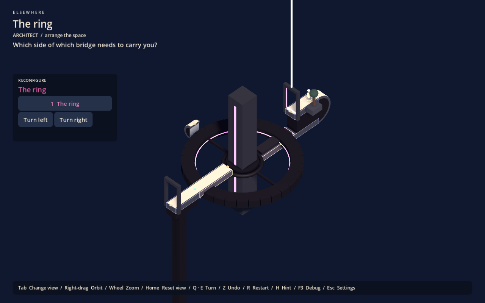

# Elsewhere level authoring

Implemented foundation, 1 October 2026. This is a scene-authoring workflow inside Godot (spec §44–48), not a production or player-facing level editor. The original authoring proposal is archived in `legacy/docs/level-authoring-proposal.md`.

## Start here

1. Reload the project, then open `monuments/the_ring.tscn`. The **Elsewhere Authoring** plugin is enabled in the project. If the dock is absent, enable it under Project Settings > Plugins. Local overrides must include it too.
2. Expand **Level** in the Scene tree. Select a path, curved transition, structure or marker and edit its data in the Inspector. These are real saved scene nodes.
3. Use **Refresh preview and validate** in the Elsewhere dock. Its preview shows the authored initial states, while the main editing viewport shows the base pose used to position children.
4. Choose a structure state in the dock. This changes an isolated preview copy; it does not rotate, save or dirty the authored nodes. Green contacts are joined, amber are open, red are invalid/inactive; blue lines show ground normals and gold lines show travel direction.
5. Select an active path, PlayerStart or Checkpoint, then press **Play From Selected Path / Marker**. It saves the scene, applies the preview states and starts at that location with matching gravity. Normal progress is neither loaded nor written during this debug launch. A later normal F6 runs normally. Path selection uses its centre (or the beginning of a curve); use a marker for an exact position.
6. F6 runs the authored scene from its normal start/save; F5 runs The Ring. The running game's Escape menu lists every scene in `monuments/`.

For a new level, duplicate one of the scenes in `monuments/`, change **Level > level_id** to a unique stable identifier, and edit the composition. Increment **revision** when changes invalidate saved contacts or state indices. Give it its own title, question, explanation and optional hints. No new gameplay script is needed. Any scene saved in `monuments/` appears in the menu automatically.

## Example monuments

| Scene | Spatial decision | Authoring coverage |
|---|---|---|
| `the_ring.tscn` | Align the inner wheel behind the ring arm, enter the hollow tower, curl underneath, turn the inner wheel again from inside, leave under the same ring arm and ride the ring to the exit ([design](designs/2026-10-01-the-ring-v3.md)) | Two independent vertical-axis rotors (inner wheel, ring), narrow necks at the tower doors for sweep clearance, explicit sockets on region paths, a fixed interior route hidden by a decorative CSG shell, first-person cues (guide line, sightline slot), authored composition |
| `the_spillway.tscn` | Swing the arm west, stand on the sluice drum and roll it over to hang beneath the keeper's landing, ride the arm north beneath it, wrap onto the north gallery, board the arm from above, swing it west again and go down the throat to the sanctuary ([design](designs/2026-10-02-the-spillway.md)) | A carrying rotor about X (the drum) whose opposite faces both bridge, a rotor about Y walkable on top and underneath, a rotor-owned 90° curl with a tail docking a fixed vertical stair, a fixed 90° curl round a rim onto an underside, state-bound water, world-down cues (falls, drips, vines, pendants, far towers), path lamps on every walkable surface, a composition test |
| `the_threshold.tscn` | Ride the sleeve until its low window lines up with the core's low slit, link into the closed core, curl over the slab, turn the sleeve again from inside and link out to the hidden balcony ([design](designs/2026-10-01-the-threshold.md)) | A rotor that carries a ledge, rings of box segments with openings (so line of sight works), fixed geometry that decides every sight line, five Spatial Links doorways, a gravity curl inside a closed tower, docking tongues that keep a wide ledge inside the sweep tolerance |
| `tests/fixtures/bell_cradle.tscn` (test fixture) | Leave the moving arm at the fixed belfry before turning it again | Vertical belfry, radial cradle, checkpoint, fixed gravity transfer and a custom torus mesh independent of path logic |
| `tests/fixtures/folded_observatory.tscn` (test fixture) | Prepare the receiver before docking fingers occupy its sweep | Folding gallery, narrow bent receiver, two-state hinge, custom rectangular walk regions and collision boxes |

The Ring is the first Phase 1 study of a different variable, which face of a structure carries you. The Spillway is the second and the first production-intent level: a place first, whose machines (a rolling sluice gate, a measuring gantry) become traversable. The Threshold asks from where you must observe a moving structure before a connection becomes visible; it uses Spatial Links, which remain an optional, experimental mechanic. The two fixtures reuse prototype positioning dependencies and exist only to exercise checkpoints, hinges and blocked sweeps; they are not in the game menu. None of these is a claim of finished architecture or validated puzzle depth. Their solutions and important counterexamples are tested. Their visual identity, difficulty and human comprehension remain design work.




Also see [the upper tower door in first person](images/the-ring-upper-door.png), [the sightline from the lower door](images/the-ring-sightline.png), [the composition after leaving upside down](images/the-ring-underside.png), [the solved composition](images/the-ring-solved.png), the [folded observatory blockout](images/authoring-observatory.png) and the [isolated editor state preview](images/authoring-state-preview.png).

## Components and coordinates

Drag the small scenes in `authoring/components/` into a level, or add an `ElsewhereComponent` and select its **kind**. Inspector fields are filtered by kind. Paths, art and sockets inherit the transform of their parent structure; a rotating component's origin is its pivot.

| Component | Data and use |
|---|---|
| WalkablePath | Local Y=0 is the walking plane, +Y is ground normal, X is the default travel axis. Dimensions X/Z define length/width; Y is thickness below the plane. Optional Rect2 regions describe connected orthogonal passages. Ordinary edges block. |
| GravityCurve90 / GravityCurve180 | Authored analytic arc toward local -Z, bending around local X. Radius, angle, width (dimensions Z), thickness (dimensions Y), and optional tangent tail define contact and ground continuously. Not a general spline or arbitrary-edge wrapper. |
| ConnectionSocket | Parent under the referenced path. Set position, outward travel direction, normal, width, type and tolerances. Generated path-end sockets can be disabled when placing explicit sockets. |
| RotatableStructure | Put attached art, paths and sockets beneath it. Set axis, ordered angle states, initial index, duration, and whether states wrap. Nonwrapping hinges stop at their end states. `carries_player=false` requires leaving the structure before it moves; otherwise the supporting path and local pose travel with it. Nested rotating pivots are rejected in this phase. |
| Interaction | A nearby F press or one-shot entry trigger changes a path's active state or a rotation lock. Optional required structure/state, persistent value and feedback are authored data. It cannot deactivate the player's occupied path. Other interaction effects are future extensions, not a general scripting editor. |
| PlayerStart | Parent under a path and reference it. Position must lie on that path, normal must match, forward must be a nonzero tangent. Author exactly one. |
| Goal | A path-bound trigger radius and completion signal. Parent under a path. The example light is a blockout marker; add a custom landmark as art. Author exactly one. |
| Checkpoint | Records player contact/orientation, ground, camera, structure states, path activity and interaction state when entered. Backspace restores it; restore is undoable. Normal restart clears the checkpoint. |
| Blockout geometry | Beam, Platform, Frame, Wall, Arch and Column are temporary helpers. They are not a required visual kit. |

All eight runtime behaviours are described through the same component script and shared runtime. The prefab scenes are convenient starting values, not special-case gameplay code.

## Art and collision

Use custom MeshInstance3D nodes or imported scene geometry alongside behaviour nodes beneath a structure. The Bell Cradle's ring demonstrates this separation. A mesh does not automatically create a walkable face, socket or collision shape.

Walkable surfaces render as a light inlay inside a dark rim (`SurfacePiece.PAVING_RIM`, 0.12 m) across their width; the rim is still walkable, so keep it narrow. Joined passages stay continuous along their length.

## Monument scale

Monuments are authored at monumental scale ([design](designs/2026-10-01-monumental-scale.md)): the player is small against wide decks and big masses. Uniform scale alone does not create size; the contrast between the player and the masses does.

- Walkable decks are **≥ 6 m** wide unless a narrow passage is the point. Then make it visibly a passage between large masses.
- Structural masses (towers, rings, frames) are **many times the player**: tens of metres. A mass the player can see past at a glance is too small.
- Doorways are portals sized to the masses, not human doors.
- Gravity curves have radius **≥ 3 m**, so they are walked at full speed.
- Masses continue beyond the playable band (into haze above and below) wherever they do not obscure the isometric composition.
- Author a new monument at this scale from the start; never scale one up afterwards. Generate regular geometry from a script in `tools/` (see `tools/gen_ring.py`, which has one `SCALE`).

Level fields that follow scale:

- **`sweep_tolerance`**: construction clearance for turn sweeps. Use 0.04 m at player scale and scale it with the monument (The Ring at ×4: 0.16 m).
- **`trigger_radius`** on the goal and on checkpoints must cover the deck's width, so arriving off-centre still counts.
- **`backdrop`**: the far scenery scene (default `world/backdrop.tscn`, from `tools/gen_backdrop.py`). It is never gameplay.

Player size, eye height, body padding, eye clearance and the camera's near plane never scale.

## First-person clearance

The eye is 1.55 m above the walking surface and must stay 0.1 m clear of every wall at every reachable spot, in every rotor configuration. Make doorways at least 0.4 m wider than the path through them, and keep jambs and door glows outside that width. When a path ends at a wall, end the walk region at least 0.1 m short of it. After any geometry change, run `tests/eye_clearance_probe.gd` (see [skill.md](skill.md)); it lists every clipping place.

Gravity curves set walking speed: speed is capped at the comfort turn rate × radius. At Normal (110°/s) and 4.5 m/s walking, any radius ≥ 2.4 m is walked at full speed; the monument-scale rule (≥ 3 m) already covers it.

## Orientation and state-bound art

- **Two lamp languages.** *Path lamps* are squat warm bollards fixed perpendicular to a walkable surface (upside down under undersides, sideways on vertical paths): "you can inhabit this". *World-gravity elements* (chains, pendants, drips, vines, falls) always hang toward true world-down: "this is which way the world is". Keep them visibly different.
- **World-down cues** make inversion felt: falling water, sinking mist and drips (`CPUParticles3D` with `local_coords` off), hanging vines and pendants, upright far towers. Put them where the player will be upside down, and ship them in the blockout. Use non-box meshes for them: the eye-clearance probe and line of sight only consider boxes.
- **State-bound art** (`authoring/state_art.gd`, `ElsewhereStateArt`): a `Node3D` whose children show only while `structure` rests in one of `states` (hidden mid-turn; particles stop emitting). Use it for presentation that answers a transformation (water pouring through an open gate). It never changes what joins.
- **Falling water**: `world/water.gdshader` on a `QuadMesh` sheet or a `CylinderMesh` column (UV.y runs down).

## Thresholds (Spatial Links, experimental)

Experimental ([design](designs/2026-10-01-spatial-links.md)); used by The Threshold and The Fold, not by The Ring.

- **Placement:** a `THRESHOLD` component is a doorway standing at the edge of its path, parented under that path. `travel_direction` points out through the doorway, and `ground_normal` is the path's ground.
- **Fields:** `width` and `aperture_height` size the opening. `trigger_radius` is how close the player must stand to prime it; scale it with the monument.
- **Link groups:** only doorways in the same `link_group` can be joined.
- **Discovery:** `initially_discovered` marks doorways the player knows from the start; others are discovered by sight within the level's `discovery_range`.
- **Validation** rejects a doorway away from its path's edge, one without a link group, and one on an edge that also forms an ordinary socket (turn `end_sockets` off there).
- **Art:** `blockout_frame` adds prototype jambs and a lintel (solid). Turn it off when the architecture provides the doorway. The seam is always added.
- **Sight lines:** design what can be seen from where (that is the puzzle) and pin it in tests, as `tests/threshold_tests.gd` and `tests/link_tests.gd` do. The player's eye turns with the structure it stands on, so only fixed geometry can make a view depend on a structure's state.
- **What hides a doorway:** line of sight tests box solids only (path decks, `GEOMETRY` boxes, doorway frames), so build walls that matter from boxes (a ring is boxes; see `ring()` in `tools/gen_threshold.py`), not CSG. A doorway's own deck never hides it: to hide a doorway from below, add a separate box under its deck.
- **Minimum and shortcuts:** run `tests/link_solver.gd` over every rotor state. It links only from poses where the runtime itself makes that doorway the source, so the minimum it finds is one a player can perform. It found The Threshold's only shortcut in blockout (a sight line from below the balcony).

## Readable movable structures

Players select by pointing at the structure in isometric; there is no HUD list. Give every rotator a distinct **tint**: it colours the hover and selection glow, and the monument's accent lights on that assembly should use the same colour. Put accent lights only on things that move; use warm white for information (guide lines, sightline targets) and destinations, and keep static architecture neutral. Any visible mesh under a rotator is clickable, including decorative art, so give each assembly enough visible mass to point at.

## Isometric composition

The isometric view is authored per monument (spec §11): set **Level > overview_focus**, **overview_size**, **overview_azimuth_degrees** and **overview_elevation_degrees**. Azimuth and elevation are relative to the player's ground frame, so the same composition is re-presented from whatever gravity the player has reached. Players cannot orbit; the wheel zooms within 0.8–1.25 and Home resets zoom. Choose the composition so it shows what the player must reason about, and deliberately leaves out what first person should discover (interiors, undersides, sightlines). The editor preview uses the same angle from upright ground.

Set a path's **blockout=false** to hide its generated structural mass and place custom artwork around its logical route. Ivory paving still marks traversal. For additional physical interference, use geometry components as box proxies matching the visible architecture. Curved and path solids retain analytic body/camera/rotation queries. Arbitrary concave mesh collision is not implemented; the current rotation sweep uses oriented boxes.

Path **collision_boxes** are expressed relative to the generated contact body's centre, which lies half the thickness below the component's walking plane. This supports recessed hinges without shortening the walking lip. Rect2 regions use local X/Z coordinates; leaving `collision_boxes` empty generates matching structural boxes for those regions. The observatory receiver is an example.

Do not use invisible proxies to invent dependencies unrelated to the visible architecture. Custom art must communicate the same physical boundaries. Adding a mesh alone does not make it safe to ignore clearance.

## Connections, states and persistence

Sockets require compatible types and widths, opposite outward travel directions, matching ground normals and coincident positions within the stricter authored tolerance. Crossing also checks the actual socket aperture and receiving walking region; nearby faces do not silently connect. A turning structure disables connections until it settles.

Angles define allowed states explicitly. Cyclic states traverse the list in the chosen direction; noncyclic states reject attempts beyond the list ends. Sweep sampling stays at most 1.5° apart (at least 60 samples), including turns larger than 90°. Rejected turns preserve state and undo history. This remains sampled clearance, not a continuous collision proof.

Each authored level writes `user://authored-<level_id>.save`. Level ID and revision guard against incompatible saves. Structure states, occupied path, local player pose, camera, path activity, interactions, completion, checkpoint and undo history persist. Active connections are recomputed from the settled geometry. Archived prototype saves (`legacy/`) use different files and are never read.

## Validation and limits

Validation reports missing/invalid starts and goals, marker/socket contact errors, invalid widths/frames, bad references, invalid state arrays, unsupported scaling/nested pivots and open contacts. An open socket is a warning because a puzzle is expected to disconnect routes. Validation does not prove solvability or fun. Preview shows current contacts, not future solutions. Runtime still checks clearance before every attempted turn.

The new monuments deliberately reuse known dependencies so authoring defects can be separated from puzzle-design experiments. Use a reasoning playtest (the archived protocol is in `legacy/docs/playtest.md`), then record where authoring friction repeats in [authoring-friction.md](authoring-friction.md). Do not infer a mature construction grammar from a few mechanically passing scenes.

## Scope decisions

| Now | Later, only with production evidence |
|---|---|
| Scene components, small blockout library, editor path/normal displays, isolated state preview, socket display, validation, Play From Here, normal save/undo/checkpoints | Socket snapping, reachable-path highlighting, editor sweep volumes, named designer snapshots, a larger production library and a dedicated authoring UI |

Mesh modelling, arbitrary physics construction, generated puzzles, automatic solving, player-facing editing and sharing/Workshop remain outside this phase, per spec §45, §47 and §53.

## Verification

Run:

```powershell
& $godot --headless --path . monuments/the_ring.tscn -- --self-test
& $godot --headless --path . -s res://tests/eye_clearance_probe.gd -- res://monuments/the_ring.tscn
```

Require exit 0, `AUTHORING SELF TEST PASS`, and no script errors. The suite exercises The Ring and both fixtures: wrong sides and ordering, both turn directions, two-state rotation, no intermediate connections, socket type/width/direction/normal/activity and apertures, interactions/conditions, occupied-ground protection, checkpoint reload, save isolation, revision/contact rejection, undo, Play From Here, forward/reverse 90°/180° traversal, visible decks matching walk regions, comfort settings, and the first-person locomotion bench. It fails if execution aborts before the final assertion.

The editor helper uses Godot's documented [EditorPlugin API](https://docs.godotengine.org/en/4.7/classes/class_editorplugin.html) and [EditorInterface API](https://docs.godotengine.org/en/4.7/classes/class_editorinterface.html). Test live editor launch, preview immutability and debug save suppression as well as headless gameplay.
