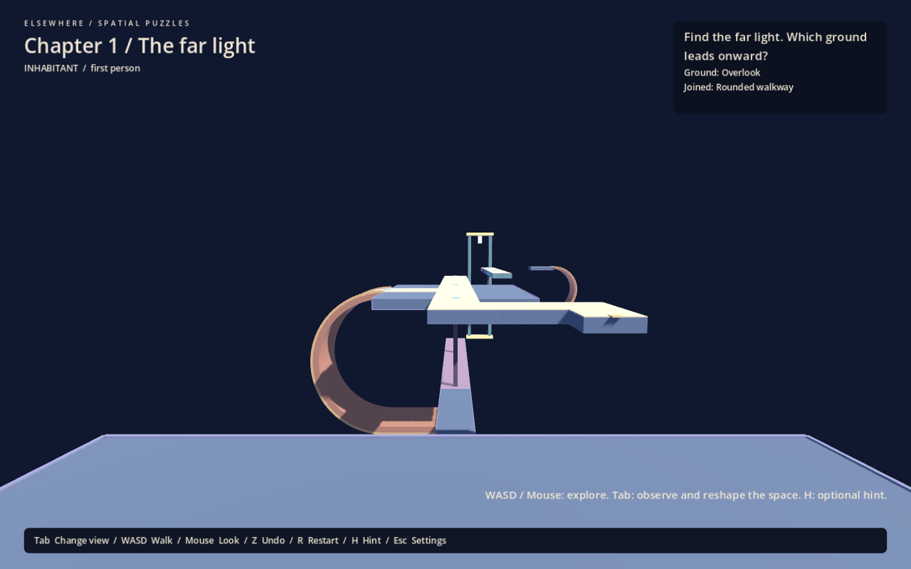
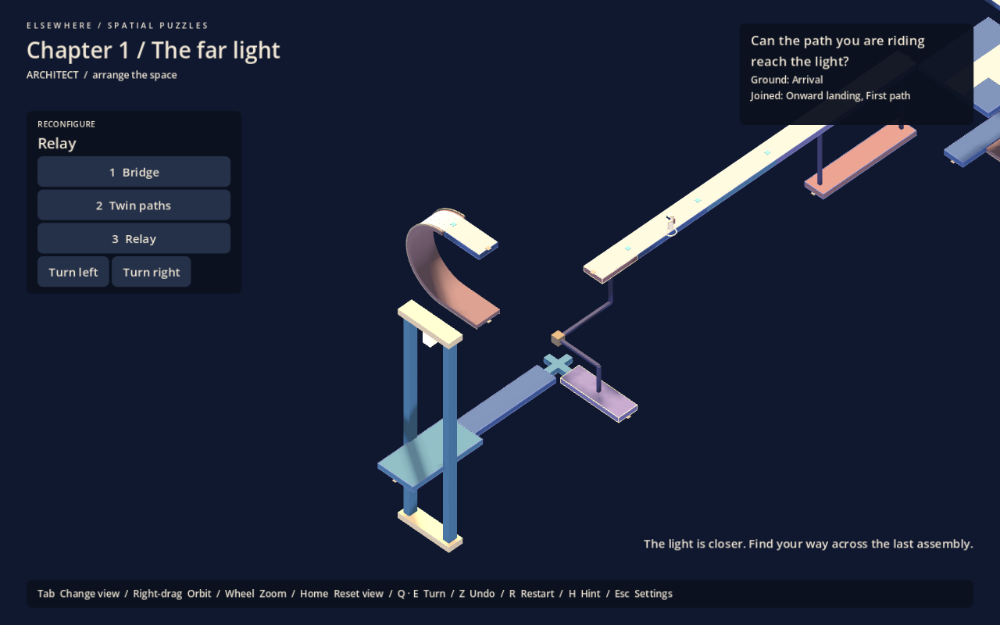

# Chapter 1 The far light

Playable blockout, 30 September 2026. This is the connected chapter described in [the chapter plan](first-chapter-plan.md), using simple geometry. It is ready for human playtesting, not vertical-slice production. The three studies, Lantern Fold and gallery remain independently selectable.

## The continuous route

| Section | Physical route | Intended discovery |
|---|---|---|
| Overlook and bridge | A fixed curve reaches the lower approach; a small occupied bridge rolls twice to a bent fixed passage | Authored curves change ground, and a structure carries the path being occupied |
| Twin paths | The passage reaches the short path's arrival; a second fixed curve reaches the long underside path; two rolls connect it onward | Correct structure configuration is insufficient when the player is on the wrong path |
| Relay | The first moving path reaches a fixed landing; stepping off lets another turn bring a different path to its curve | Preparation can mean leaving a moving structure and waiting on fixed ground |
| Quiet passage and light | The relay's inner landing leads along a fixed underside passage to the original landmark | The destination is familiar, but the route has changed the direction of approach |

There are no scene transitions, teleports, progress locks or new levers along this route. Endpoints and world normals create the connections. Earlier assemblies remain present and retain their configurations. The carrier relationships reuse Studies 1 and 2 under a common world; their standalone layouts are preserved.

The second bridge landing is narrow at the relay's centre to clear its rotating paths. Its visible cross-shaped paving must be approached near the path centre. This is a readability point to observe in playtesting, not an additional intended puzzle.

## Camera and interaction

First person and isometric B remain the chosen pairing. The chapter starts in first person looking toward the far light. Tab changes view; 1, 2 and 3 select Bridge, Twin paths and Relay. Q/E turn structures. Right-drag, wheel and Home retain the overview inspection controls.

Overview framing has three fixed assembly centres. Crossing a fixed connecting surface changes the active centre and recommended size over 0.85 seconds, without resetting ground transport, manual angle or zoom. Moving-support traversal does not choose a new centre, and turns and pauses suspend the transition. The bent passage supports framing changes in both directions for backtracking. The active mechanism is selected when the framing zone changes; the player can still select any mechanism.

Chapter reconfiguration controls sit beneath the title to avoid covering the onward landings. Adjacent assemblies remain visible where they enter the view. The existing material palette, joined-contact inlays, bridge silhouettes and two-sided destination frame are a small visual-language sample rather than finished art.

H offers three escalating hints for the active section. The final section asks whether the occupied path reaches the light without immediately telling the player to step off. Completion offers an optional explanation and **Look back / keep exploring**; the chapter reflection can be reopened from Escape.

## Saves and recovery

`user://chapter-one.save` is separate from both `positioning.save` and the gallery's `journey.save`. It stores all three configurations, passenger contact, transported camera frame, manual view, active framing transition, undo history, view mode and completion state. Selecting the chapter resumes that file if present. Selecting a prototype resumes its saved state when its layout matches the prototype save.

Settled turns, settled framing-zone crossings, pausing, undo, restart, completion, menu changes and normal close requests save progress. Tests invoked with `--self-test` do not write save files. Restart restores the chapter's initial route and position. Undo can return to an earlier assembly after a save/reload. Ordinary return turns and walking also provide recovery; undo is not the only way back.

## Verification

`chapter_tests.gd` joins the normal positioning suite and prints `CHAPTER SELF TEST PASS`. It walks the complete route using actual support transitions and rotation commands, checks both wrong-position examples, walks back to the initial overlook, serializes and rebuilds a saved chapter, verifies undo across assemblies, checks prototype-save isolation, resumes completion, tests post-completion exploration, and checks camera-focus continuity without losing B orientation or manual orbit.

The original positioning, Lantern Fold, overview and gallery checks remain required. Live Godot MCP Pro inspection covers the opening sightline, all three overview framings, first-person underside arrival, completion and chapter selection. Mechanical tests establish those cases, not universal camera comfort, difficulty or a successful learning progression.

## Next decision

Use the observation protocol in [first-chapter-plan.md](first-chapter-plan.md) with players unfamiliar with the studies. Record predictions, hints, wrong-order recovery and explanations. In particular, check whether stepping off at the relay feels like a new application of positioning, whether the central landing reads clearly, and whether the final landmark is recognized from below. Revise the route before adding mechanics or finishing the whole chapter's visuals.
