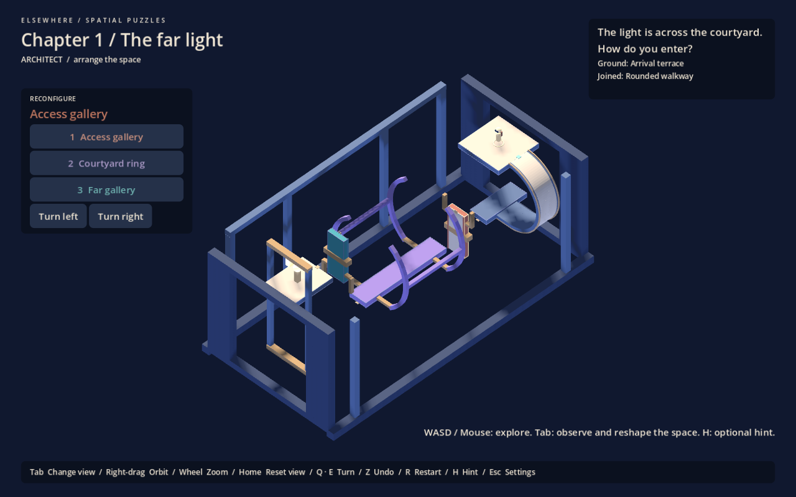
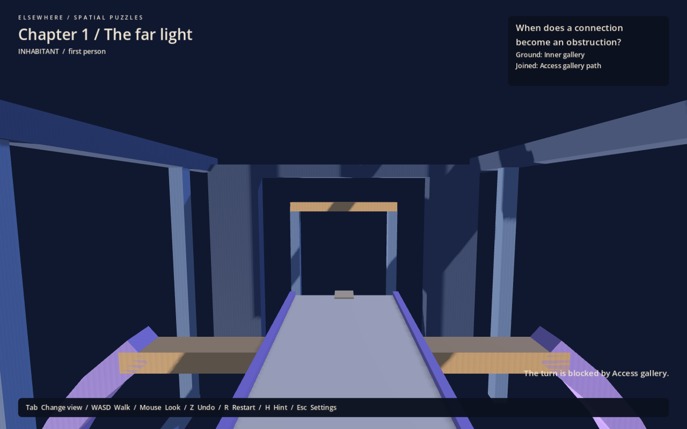

# Chapter 1 / The far light ? turning courtyard

Revised playable blockout, 30 September 2026. A compact courtyard replaces the former chain of three assemblies. First person and isometric B remain the chosen pairing. The three studies, Lantern Fold and optional gallery remain selectable and unchanged in layout.

## Intended discovery

**The gallery that let me enter is now preventing the transformation I need to leave.**

The access gallery and ring are interdependent. Moving the gallery remotely is always permitted when its sweep is clear; the player must get off it and onto the ring before withdrawing it. Riding each mechanism and rotating until a route appears is insufficient.

## Continuous route

| Section | Physical relationship | Reasoning |
|---|---|---|
| Arrival terrace and outer gallery | Fully walkable terrace connects to a curved exterior gallery and underside landing | Explore the same building above and below; identify the remote light |
| Access gallery | A folded gallery can be lowered between the underside landing and ring | Opening a connection permits entry, but occupies the ring sweep |
| Courtyard ring | Stand on its inner gallery; withdraw the access; roll twice | Leaving the access gallery before folding it is necessary, even with remote manipulation |
| Far gallery | Unfold the receiving gallery after the ring arrives | Apply the clearance relationship from the departure side; opening it early blocks the final roll |
| Light terrace | The original landmark is reached across the same framed void | Look back and recognize how the route fits together |

The ring rolls about X; both galleries fold about Z. These axes are implementation coordinates, not colour meanings. The ring has one walking path and open architectural ribs, not automatic traversal around arbitrary surfaces. Authored endpoint position and normal determine every connection. No progress flag, lever, teleport or camera restriction gates the route.

Two brass cheeks on each gallery extend beside the walking channel. They let the gallery fold clear, but physically obstruct the ring's roll. Both roll directions are blocked while docked; either clear half-roll solves the route. Trying to rotate reports the named obstructing gallery and preserves the player, arrangement, camera and undo history.

## Architectural direction and colour

The provisional setting is a turning cloister: paired open arch ribs, folding galleries, a colonnade and shared foundation frame a central courtyard. The curved approach belongs to the arrival terrace, and the landmark frame belongs to the opposite terrace. This is an architectural blockout, not a confirmed toy planetarium or final production theme. See [art direction](art-direction.md).

Movable assembly identities remain stable through every orientation: **terracotta access gallery, violet ring, teal far gallery**. Selector labels use matching colours. Fixed structure and the fixed curve are blue-grey; ivory paving identifies walking surfaces, and brass identifies mechanical joints. Colour does not encode gravity or XYZ. Distinct silhouettes and named controls supplement colour.

The terrace is walkable across its visible surface. There are no broad paving slabs restricted to unexplained invisible stripes. The ring and galleries have narrow visible edges. The courtyard foundation is an open frame, not a false walkable floor. Windowed end piers and the far colonnade leave the recommended overview open; the raised light remains visible above the folded receiving gallery.

## Camera, recovery and persistence

Tab changes view; 1/2/3 select Access gallery, Courtyard ring and Far gallery; Q/E turn them. Right-drag, wheel and Home retain manual inspection. The compact chapter uses **one shared overview centre**, preserving the whole courtyard and landmark as B transports the camera with the player's ground. Zone metadata changes questions and initial selection on fixed ground, never connections. H gives escalating optional hints.

`user://chapter-courtyard.save` stores all configurations, contact, both camera layers, zone, undo history, view mode and completion. The former `chapter-one.save`, prototype `positioning.save` and gallery `journey.save` are preserved. Old chapter data is rejected by layout identity rather than applied to incompatible node paths.

Undo and restart remain available. Wrong ordering also recovers through ordinary movement and withdrawal. Completion offers **Look back / keep exploring**. The entire return route works: board the ring from the light terrace, withdraw the far gallery, return the ring, unfold the access gallery, cross and follow the outer curve back to arrival. Reflection can be reopened from the menu.

## Verification and remaining questions

`chapter_tests.gd` checks the complete route in both ring directions; remote pre-rotation losing access; staying aboard the access gallery; both blocked ring directions; premature far-gallery deployment and recovery; all 64 quarter-turn contact combinations; reverse traversal; rejected-turn immutability; isolated save/reload and undo; old-layout rejection; completion and reflection; full terrace contact; stable composition and manual orbit.

The positioning, Lantern Fold, overview and original gallery regressions remain required, including a clean checkout without local addons. Live Godot MCP Pro inspection checks the rendered arrival, overview, underside gallery, obstruction feedback and destination.

Mechanical and selected visual checks do not establish unaided understanding, difficulty, colour accessibility or comfort. A blind playtest must establish whether the obstruction is legible before an error, whether the final gallery feels like a changed application, and whether the courtyard feels inhabitable. Keep the geometry easy to revise before producing final art.
