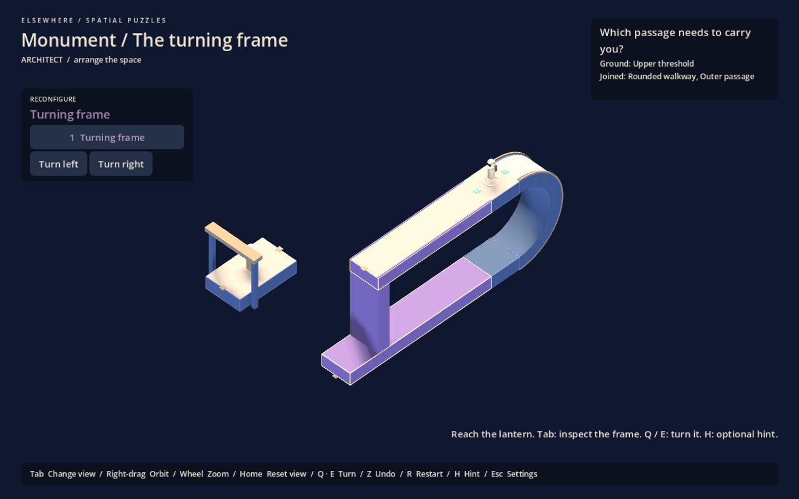
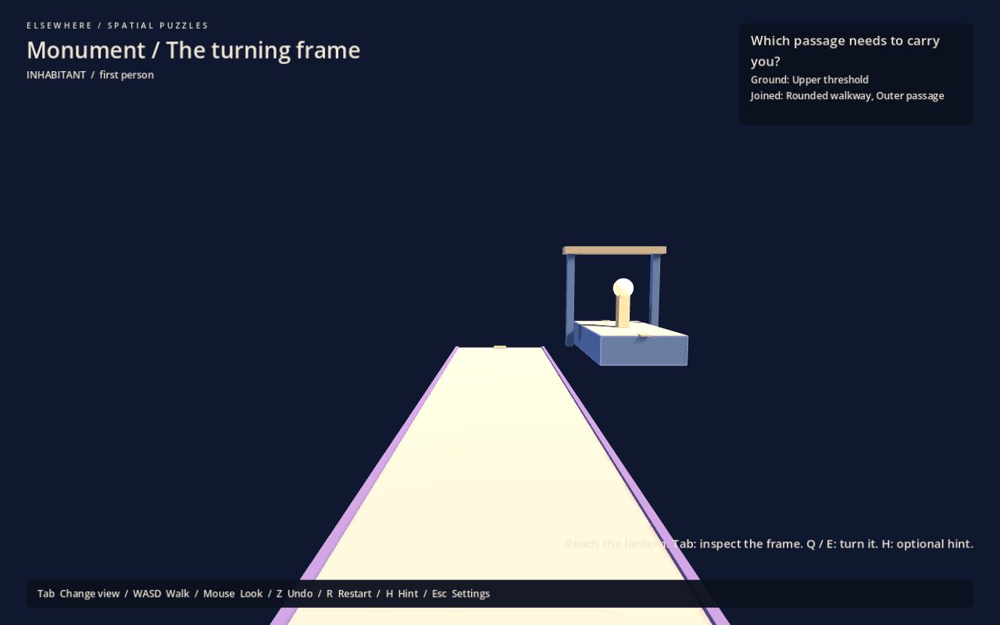
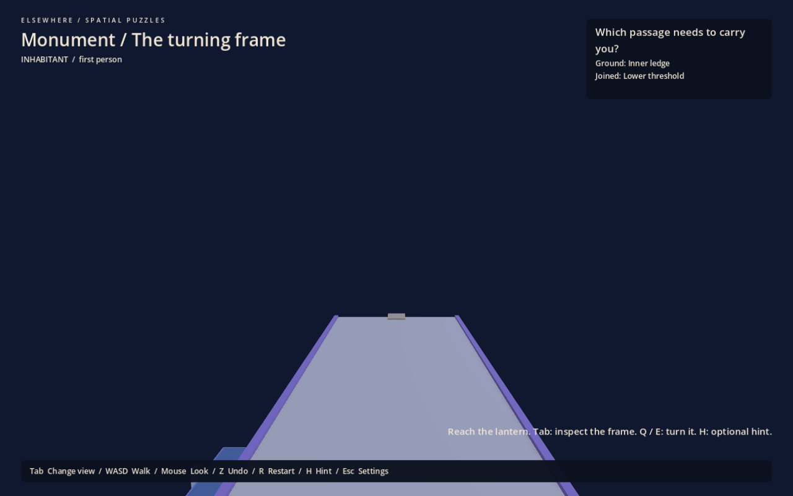

# The turning frame

Architectural blockout study, 1 October 2026. Open **Escape > The turning frame**, or run `scenes/monument.tscn` with F6. F5 still opens the courtyard. All earlier puzzles remain available.

## Purpose and form

Test the reference's visual economy with one dominant frame, one central opening, one moving assembly and one lantern destination. The frame's upper passage and longer underside ledge are the actual routes. Its fixed rounded end is the gravity transition, with the same structural thickness as the straight beams. No surrounding pavilion or additional mechanism was added.

Blue-grey identifies the fixed end and destination; violet identifies the complete moving frame. Ivory paving and end contacts retain their established meanings. The first-person route is two units wide on flat ground, with the existing rounded path's narrower paving and edge trim. This is a geometry study, not a finalized theme or material treatment.

## Positional decision

**Which passage needs to carry you?**

The tempting route is straight onto the upper passage. That passage is too short to meet the lantern landing in any orientation. The longer underside ledge belongs to the same assembly but is a separate walking surface. Turning carries the occupied surface; it cannot transfer the player between the two.

Turning the empty frame toward the destination also removes both connections to the fixed starting end. Remote manipulation remains allowed. The dependency comes from reach, offset and authored ground, without a progress gate or a new collision lock.

This deliberately reuses Study 1's path-choice dependency in consolidated architecture. It tests whether a simpler form communicates the existing reasoning better; it does not claim a new puzzle mechanic or the depth of a whole chapter.

Solution and recovery

1. From arrival, turn around and follow the rounded end onto the underside threshold.
2. Continue onto the longer violet ledge.
3. Switch to isometric view and turn the frame twice in either direction.
4. Return to first person and cross to the lantern.

If the frame was turned too early, turn it back to board. If aboard the wrong passage, return the frame and walk back to the rounded end. Both mistakes are physically recoverable without restarting; Z also restores the previous turn and passenger position. H provides three optional hints. Completion offers an optional explanation and continued exploration.

## Geometry and implementation

The fixed radius-three return connects ground at Y=3 and Y=-3, at Z=-2. The upper moving passage spans X=-4 to 4; the lower ledge spans X=-4 to 6. Both share one pivot about world X. A half-roll brings the lower ledge to Y=3, Z=2, meeting the lantern landing at X=6. The short passage never reaches that edge. Ordinary unmarked edges remain impassable.

`monument_layout.gd` composes the study; `monument_tests.gd` verifies its dependency and recovery. It uses the existing walker, ground-relative isometric B camera, turn clearance, undo and HUD. `monument-frame.save` has a `turning_frame` identity guard and separate completion/history, leaving courtyard and older progress isolated.

## Views and next judgment

The overview exposes the opening, rounded end, separate passages and offset destination. At walking height the underside remains visually sparse: substantial beams alone have not yet established a rich inhabited interior. Keep this limitation visible during review rather than filling the opening with props.

Before extending this into a chapter, ask a player to predict which passage reaches the light and explain why rotating from arrival is insufficient. Judge whether the fixed/moving seam and underside paving are readable in both views. Mechanical tests and selected screenshots do not establish human understanding or comfort.
