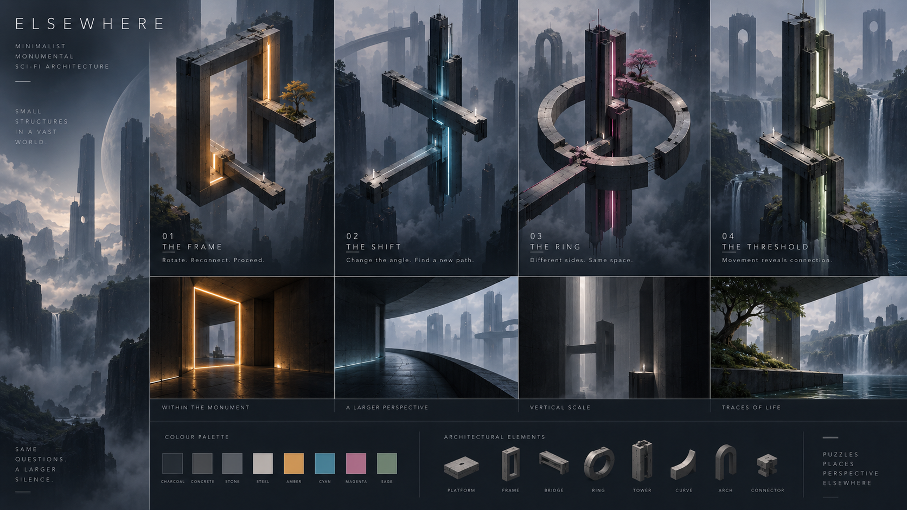

# SPEC.md — ELSEWHERE

## 0. Document Status

**Project:** Elsewhere  
**Genre:** First-person architectural puzzle adventure  
**Mode:** Single-player  
**Core perspectives:** First-person exploration + isometric architectural manipulation  
**Current stage:** Prototype / pre-production  
**Primary design goal:** Build compact architectural monuments in which the player must reason about **where they need to be before changing the space**.

This document consolidates the current direction of the project. Confirmed decisions are treated as the baseline; ideas that still require testing are explicitly marked as such.

This spec is the design authority. Operational guidance for working in the repository lives in [skill.md](skill.md). The visual concept board is described in [Appendix A](#appendix-a--concept-reference); what is implemented today is summarized in [Appendix B](#appendix-b--implementation-status). Earlier prototype documents are archived, unchanged, in `legacy/docs/`.

---

# 1. High Concept

**Elsewhere** is a first-person spatial puzzle game set among small, monumental structures suspended within an enormous, quiet science-fiction world.

The player physically explores these monuments in first person. Gravity follows authored architectural paths, allowing corridors to bend around walls, ceilings and undersides without the player falling away.

At any time during appropriate puzzle states, the player can enter an **isometric architectural view**. From this perspective, the monument becomes a readable object that can be inspected and reconfigured.

Structures rotate, shift or reconnect. If the player is standing on a moving structure, they move with it.

The challenge is not simply:

> “How should this structure be rotated?”

It is:

> **“Where do I need to be before I transform the space?”**

A correct architectural configuration may still be useless if the player occupies the wrong side, path, face or structure.

The game therefore combines:

**Observation → exploration → positioning → transformation → consequence → discovery.**

---

# 2. Elevator Pitch

> **Explore monumental sci-fi architecture in first person, then pull back into an isometric view to reshape it. Walk across changing gravity, position yourself inside moving structures, and discover how where you stand changes what the world can become.**

---

# 3. Player Fantasy

The player is simultaneously:

- an **inhabitant** of the architecture;
- an **observer** who can understand it from outside;
- and an **architect** who can temporarily alter how its parts connect.

From far away, each puzzle is a clean architectural composition.

From inside, that composition becomes enormous.

A narrow line visible in isometric view becomes a broad corridor.  
A small ring becomes a curved gallery.  
A frame becomes a monumental wall surrounding a void.

The player repeatedly experiences:

> “I was inside *that*?”

This change in scale and understanding is a fundamental part of the game.

---

# 4. Core Design Pillars

## 4.1 Architecture Is the Puzzle

Levels are not obstacle courses placed inside decorative environments.

The architecture itself must provide:

- traversal;
- gravity changes;
- moving structures;
- connections;
- landmarks;
- puzzle constraints;
- and the level's visual identity.

Removing the architectural form should also remove the puzzle.

A level should not feel like:

> Platform → mechanism → platform → mechanism → goal.

It should feel like:

> **Exploring and understanding one coherent monument.**

---

## 4.2 Position Before Transformation

The player should frequently understand where a structure needs to go **before** they understand where they themselves need to be.

Example:

A rotating frame can align perfectly with the exit, but the player is standing on its outer path while only its inner path connects to that exit.

The player therefore needs to:

1. find a way onto the correct path;
2. prepare their position;
3. transform the structure;
4. use the resulting connection.

This relationship between **player state and world state** is the central source of puzzle depth.

---

## 4.3 Two Views, One World

First-person and isometric modes are not separate gameplay layers.

They show the same physical puzzle state from different scales.

### First person answers:

> “Where am I, and how can I physically move through this place?”

### Isometric view answers:

> “How is this place constructed, and what can I change?”

Neither perspective should completely replace the other.

---

## 4.4 Small Monuments, Deep Possibilities

Levels should favour:

- few elements;
- strong silhouettes;
- clear relationships;
- reusable pieces within the same puzzle;
- multiple functions for the same architecture.

Complexity should primarily come from **relationships and configurations**, not from increasing object count.

A small monument with three meaningful states is preferable to fifteen independent rotating platforms.

---

## 4.5 Quiet Wonder

The game is contemplative rather than stressful.

There is no requirement for:

- combat;
- precision jumping;
- lives;
- time pressure;
- reflex challenges.

The desired rhythm is:

> See something strange → understand part of it → form a hypothesis → transform it → walk through the result.

---

# 5. Primary Gameplay Loop

The standard loop is:

### 1. Arrive

The player enters a new architectural monument.

A destination, landmark or intriguing inaccessible space is often visible early.

### 2. Explore

The player walks through the accessible structure in first person.

They discover:

- paths;
- gravity transitions;
- separate routes;
- interactable mechanisms;
- movable structures;
- viewpoints.

### 3. Observe

The player presses **Tab** to enter isometric view.

They see the active puzzle as a whole.

### 4. Plan

They identify:

- their own position;
- possible transformations;
- currently available connections;
- areas they have not yet reached.

### 5. Reconfigure

They rotate or move a valid structure.

### 6. Experience the Consequence

If standing on the structure, the player moves with it.

Connections may open or close.

### 7. Return to First Person

The player physically traverses the new configuration.

### 8. Re-evaluate

The new position reveals another relationship or makes an earlier structure useful in a new way.

### 9. Reach the Destination

The solution produces a meaningful spatial reward: arriving somewhere previously visible, entering an interior, reaching a landmark, or seeing the monument from a new orientation.

---

# 6. First-Person Exploration

First person is the **primary gameplay perspective**.

The player can:

- walk;
- look freely;
- interact with nearby world objects;
- follow authored paths;
- cross gravity transitions;
- enter and leave movable structures.

The experience should emphasize environmental scale.

A compact structure in isometric view may feel monumental at eye level.

## 6.1 No Default Jump

Baseline design assumes no free jump mechanic.

Jumping could undermine carefully authored path relationships and create accidental shortcuts.

This can be revisited only if a clear design need emerges.

---

# 7. Traversal and Gravity

Gravity is **surface-relative along authored traversal paths**.

The player does not automatically attach to every wall in the environment.

Ordinary edges block traversal unless an authored connection exists.

## 7.1 Gravity Curves

Curved paths allow continuous transitions such as:

- floor → wall;
- wall → ceiling;
- upright → upside-down;
- exterior → underside.

These transitions should be smooth and predictable.

The player follows the curve rather than manually activating gravity.

## 7.2 Why Paths Are Authored

Allowing unrestricted wall walking would make many puzzle constraints difficult to control.

Authored traversal allows:

- deliberate routes;
- readable puzzle boundaries;
- clear transitions;
- controlled access to different faces.

Visual design must make the path boundaries believable.

Avoid large surfaces that appear freely traversable when invisible gameplay restrictions say otherwise. **A surface presented as walkable matches its authored walkable region.** Walls, trims, supports, parapets and other structural mass may surround it. Make boundaries readable through silhouette, material, deck thickness and lighting before adding physical lips.

---

# 8. Isometric Architectural View

Pressing **Tab** changes from first person to an isometric overview.

The purpose is:

- spatial comprehension;
- puzzle inspection;
- structure manipulation.

It is not a separate map screen.

The player remains visibly represented within the architecture.

The isometric view is an **authored representation of the current monument**, not a freely orbiting 3D camera. It is excellent for understanding topology and manipulating structures, but it is deliberately not omniscient: interiors, undersides, depth relationships and perspective alignments are discovered in first person.

> **First person discovers why a configuration matters. Isometric view lets the player act on it.**

---

# 9. Isometric Camera

## 9.1 Puzzle-Centred

Each puzzle defines a fixed architectural centre.

The isometric camera looks toward that centre rather than directly following the player's position.

This preserves the composition of the monument.

## 9.2 Ground-Relative Orientation

The camera treats the player's current supporting surface as its reference ground.

If the player travels around a gravity curve, the overview gradually changes orientation with that ground.

By the time the player reaches the underside of a structure, the overview may effectively be upside-down relative to its original orientation.

## 9.3 Preserve Heading Across Connections

Crossing between compatible pieces should not cause an arbitrary front-to-back camera flip because the destination object's local orientation differs.

Viewing continuity should be preserved.

## 9.4 Character Look Does Not Affect the Isometric Camera

Turning the player's head or looking around in first person does not rotate the architectural view.

The two orientations are independent.

---

# 10. Isometric Camera Rotation — Chosen Direction

A key camera rule is:

> **The camera follows changes in gravity, not every rotation of the occupied structure.**

If the structure beneath the player tilts and the ground normal changes, the camera reorients accordingly.

If the structure simply rotates around the existing ground normal—like a turntable—the player and structure rotate, but the isometric camera should not automatically orbit with them.

This helps the player clearly see:

> “The structure moved relative to the rest of the monument.”

rather than making the structure appear stationary while the world turns around it.

---

# 11. Authored Isometric Composition

*Changed 1 October 2026: replaces manual orbit. See `designs/2026-10-01-the-ring-v3.md`.*

Each puzzle defines a deliberate composition:

- an architectural centre;
- an azimuth;
- an elevation;
- a base framing size.

These are designed for that specific monument, so its silhouette, foreground and background read as an iconic, almost illustrated composition.

The camera remains ground-relative (§9.2–§10). When gravity changes, the player sees **the same monument from their new orientation**. That view is earned by moving through the architecture, never produced by dragging the camera.

Players **cannot rotate** the view. Spatial information hidden by the composition is discovered through first-person exploration rather than camera manipulation.

Allowed readability aids:

- **zoom** (0.4–1.6 × the authored framing) and **bounded pan** (right/middle-drag or WASD, at most half the framing size). Both keep the authored angle. Closed shells still hide interiors at any zoom;
- contextual occlusion handling: the player silhouette, and, where testing shows a need, cutaways, fades or selection outlines.

**Tab reveals the current composition and never resets zoom or pan.** A **Reset View** command (Home) restores the authored framing.

Alternative fixed viewpoints (for example 90° snaps) are not part of the baseline. Add them only for a specific relationship that playtesting shows is unreadable.
---

# 12. Structure Manipulation

Movable architecture uses **authored discrete transformation states**.

Examples:

- 0°;
- 90°;
- 180°;
- 270°;

or simply:

- State A;
- State B.

Not every structure requires four states.

## 12.1 Transformable Structures

Potential forms include:

- frames;
- bridges;
- galleries;
- rings;
- vertical towers;
- carriers;
- rotating corridors;
- articulated architectural sections.

## 12.2 Player Attachment

If the player stands on a structure during transformation:

- local position is preserved;
- local orientation is preserved;
- the structure physically carries the player;
- the resulting ground orientation becomes meaningful after the transformation.

The player is not teleported into place afterward.

---

# 13. Connections

Connections define where traversal can continue between architectural pieces.

A valid connection must account for:

- position;
- travel direction;
- supporting ground orientation;
- compatible path width;
- current structure state.

Connections activate only when a structure reaches an authored settled state.

Intermediate animation positions should not accidentally create temporary paths.

---

# 14. Puzzle State

The state of a puzzle is not merely the rotation of its objects.

Conceptually:

```text
Puzzle State =
Structure configurations
+ Active connections
+ Interaction states
+ Player position
+ Player occupied path / surface
```

This means two visually identical world configurations can still produce different gameplay situations depending on where the player stands.

This is intentional.

---

# 15. Core Puzzle Philosophy

The player should rarely solve meaningful later puzzles simply by:

> Board → rotate → leave → repeat.

Instead, puzzles should introduce relationships such as:

### Configuration conflict

The state that lets the player enter is not the state that lets them leave.

### Positional dependency

The destination connects only to a different path on the same structure.

### Preparation

A second structure must be arranged before the player moves into a location that changes their access.

### Reuse

A structure crossed earlier becomes useful again under a different configuration.

### Obstruction

A structure needed for access later prevents another transformation and must be repositioned.

Any such restriction must be understandable through the established geometry or rules—not arbitrary.

---

# 16. Puzzle Design Template

Every meaningful puzzle should answer three questions.

## Expected first idea

What will the player reasonably try?

Example:

> Rotate the frame toward the exit.

## Why that is insufficient

What understandable consequence prevents this from being the complete solution?

Example:

> Only the frame's inner path reaches the exit, but the player currently occupies the outer path.

## Required discovery

What relationship must the player understand?

Example:

> Reach the inner path while the frame is in the entrance state, then rotate it while standing there.

If the discovery is simply:

> “Rotate again until it connects,”

the puzzle probably needs more depth.

---

# 17. Experimentation

The game encourages hypothesis testing.

Good puzzle flow:

> **Observe → predict → try → receive information → revise.**

Failure should ideally teach something.

Good:

> “I reached the correct structure, but I'm on the wrong side.”

Weak:

> “Nothing happened. I'll rotate everything randomly.”

The game should provide enough visual information that deliberate reasoning is possible.

---

# 18. Undo

The player can undo recent architectural transformations.

Undo exists to encourage experimentation rather than punish incorrect hypotheses.

Undo must restore a valid state including relevant player transformation information.

It should not produce invalid cases where the architecture returns to a state incompatible with the player's current position.

Implementation may therefore require puzzle snapshots rather than simply reversing the last transform animation.

---

# 19. Checkpoints

Checkpoints occur at stable puzzle states and major progress points.

Potential stored information:

- player position;
- player orientation;
- current supporting path;
- structure states;
- interaction states.

Reloading should always return the puzzle to a valid configuration.

---

# 20. Impossible Geometry

**Impossible spatial connections are not a core requirement.**

Earlier prototypes explored gallery connections that behaved as spatially impossible passages.

The system may remain available as a special mechanic later, but the game must be able to produce strong puzzles using:

- physical architecture;
- changing gravity;
- positioning;
- rotation;
- connected paths.

Impossible geometry should only be introduced if it creates a specific worthwhile puzzle idea.

It should not exist merely because *Monument Valley* uses impossible perspective.

---

# 21. World Structure

Current preferred direction:

> **A continuous journey through individual architectural monuments.**

The world should feel much larger than the current puzzle.

A monument may be physically isolated or connected through transitional spaces, but the player should feel they are travelling through one coherent setting.

The structure is **not currently intended to be a conventional open world**.

Individual puzzle assemblies remain:

- compact;
- understandable;
- visually identifiable.

Distant architecture establishes scale and future destinations.

---

# 22. Level Identity

Every major puzzle should have a recognizable architectural idea.

Examples:

- The Turning Frame;
- The Ring;
- The Threshold;
- The Shift;
- The Elevator;
- The Courtyard;
- The Spiral;
- The Split Tower.

These names describe conceptual forms, not necessarily final level titles.

Each monument should ideally be recognizable from silhouette alone.

---

# 23. Two-Scale Environmental Design

The world should communicate differently in each perspective.

## In isometric view

The player recognizes:

- the monument's overall shape;
- its composition;
- its main visual identity;
- how parts relate spatially.

## In first person

The monument becomes environmental atmosphere.

The player may no longer recognize the whole object.

Monuments are authored at monumental scale: the player is small against wide decks and masses many times their size (see the [monumental scale design](designs/2026-10-01-monumental-scale.md)).

Instead they experience:

- material;
- height;
- openings;
- light;
- void;
- structural thickness;
- fragments of distant architecture.

This contrast is intentional.

---

# 24. Art Direction

## Core description

> **Minimalist monumental sci-fi architecture suspended in a vast, quiet world. Dark concrete, restrained emissive lighting, large geometric forms, and occasional traces of nature. Each puzzle is a small architectural monument with a strong silhouette and its own visual identity.**

The world should feel futuristic without becoming conventional neon-heavy cyberpunk.

---

# 25. Architectural Language

Prioritize:

- large geometric masses;
- strong frames;
- rings;
- arches;
- long slabs;
- vertical towers;
- voids;
- curved galleries;
- asymmetrical extensions.

The monument should remain legible from a distance.

Avoid excessive:

- piping;
- exposed machinery;
- tiny technological details;
- decorative clutter.

---

# 26. Movement Aesthetic

Not every movable structure should look mechanically engineered.

Some can contain:

- visible rails;
- pivots;
- mechanical supports.

Others may move almost silently and inexplicably.

This creates a balance between:

**technology** and **architectural mystery**.

The world should not feel like an industrial factory.

---

# 27. Materials

Baseline material family:

- charcoal concrete;
- dark stone;
- painted architectural panels;
- dark brushed metal;
- smoked glass where appropriate;
- ivory or pale stone accents.

Materials should remain relatively simple so geometry dominates.

Surface wear can exist, but should be restrained.

---

# 28. Emissive Colour Rule

Use:

> **Neutral architecture + one dominant emissive accent + occasional secondary light.**

Examples:

### Monument A
Charcoal + ivory + amber

### Monument B
Steel + cyan

### Monument C
Black + restrained magenta

### Monument D
Concrete + pale green

Avoid using magenta, cyan and orange everywhere simultaneously.

Colour should help give each monument its own memory and mood.

It is not a rigid gameplay code.

---

# 29. Nature

Nature appears sparingly.

Examples:

- one tree growing from a terrace;
- moss on an abandoned edge;
- small hanging plants;
- grass around a quiet courtyard;
- water far beneath the architecture.

Natural elements should create contrast against monumental geometry.

They should not turn every level into an overgrown ruin.

---

# 30. Background World

The environment beyond the puzzle should reinforce enormous scale without overwhelming the active structure.

Possible backgrounds include:

- gigantic towers disappearing into mist;
- empty sky and void;
- distant architectural monoliths;
- waterfalls;
- water kilometres below;
- huge interior spaces;
- abandoned structures;
- occasional city silhouettes.

Avoid placing every monument against the same dense cyberpunk skyline.

The background is context, not the primary subject.

---

# 31. Lighting

Lighting should be cinematic but readable.

Priorities:

- clear monument silhouette;
- controlled pools of light;
- readable paths;
- strong contrast around goals and openings;
- atmospheric depth.

A destination may be represented by:

- a bright opening;
- illuminated doorway;
- vertical light source;
- distinctive glowing architectural element.

The player should often be able to identify:

> “I want to reach that.”

before knowing how.

---

# 32. First-Person Visual Density

First person should remain relatively minimal.

Immersion comes from:

- scale;
- lighting;
- sound;
- material response;
- architectural thickness;
- vistas.

It does not require filling corridors with props.

A huge dark wall, a luminous doorway and a distant skyline can be more effective than dozens of decorative objects.

---

# 33. UI

The final player-facing UI should be minimal.

Current debug UI contains substantial information, but the production presentation should avoid continuously exposing:

- puzzle state names;
- developer path labels;
- connection debugging;
- internal ground names.

The final experience should communicate primarily through the world.

Persistent player UI should be limited to what testing proves necessary.

---

# 34. Controls — Current Direction

### First Person

**WASD** — Move  
**Mouse** — Look  
**F** — Interact  
**Tab** — Enter / leave isometric view

### Isometric

**Click a structure** — Select it (it glows; no on-screen list)  
**Q / E** — Rotate selected structure  
**Mouse wheel** — Zoom  
**Right drag / WASD** — Pan  
**Z** — Undo  
**Home** — Reset framing  
**Tab** — Return to first person

Exact inputs remain subject to usability testing and remapping support.

---

# 35. Audio Direction

The world should sound large, quiet and slightly mysterious.

Potential ambient elements:

- distant wind;
- deep structural resonance;
- faint city ambience far below;
- environmental hum;
- distant water;
- occasional architectural movement.

Puzzle transformations should feel substantial but elegant.

Avoid overly industrial machinery sounds unless appropriate to a specific monument.

A structure might move with:

- deep stone resonance;
- restrained mechanical tones;
- subtle harmonic sound;
- low-frequency movement.

Audio should reinforce the sense that the architecture itself is alive or responsive.

---

# 36. Music

Music should be sparse and atmospheric.

Likely direction:

- ambient electronic;
- minimal melodic elements;
- evolving textures;
- long quiet passages.

Music should support concentration rather than continuously demand attention.

A solved transformation or arrival at a landmark may produce a musical response.

---

# 37. Narrative Direction

Narrative should remain lightweight unless future development proves a stronger narrative necessary.

The player is travelling through a vast collection of transforming monuments.

The world should generate questions:

- Who built this?
- Why does it move?
- Why is it largely empty?
- Where are we going?
- What exists beyond the next structure?

These questions do not need immediate exposition.

Environmental storytelling is preferred over:

- long dialogue;
- quest logs;
- extensive cutscenes.

The architecture itself should carry much of the mystery.

---

# 38. Player Character

The player needs enough visual presence to be recognizable in isometric view.

Exact identity and narrative role remain **TBD**.

Requirements:

- strong readable silhouette;
- recognizable at small isometric scale;
- does not visually compete with the architecture;
- believable locomotion across unusual gravity orientations.

The character does not currently require combat abilities or complex inventory systems.

---

# 39. Progression Philosophy

Difficulty comes from increasing the relationships between familiar rules rather than endlessly introducing new mechanics.

Example progression:

### Early

Understand:

- paths;
- gravity curves;
- isometric view;
- simple rotation;
- being carried.

### Developing

Understand:

- separate paths on one structure;
- player position before rotation;
- entry configuration versus exit configuration.

### Intermediate

Combine:

- multiple movable structures;
- preparation order;
- reuse of earlier architecture;
- transformations that influence one another.

### Advanced

Require:

- multi-step planning;
- revisiting structures in different states;
- several spatial relationships understood simultaneously;
- misleading but logical apparent solutions.

Later puzzles should challenge assumptions about known systems without arbitrarily breaking their rules.

---

# 40. Chapter Structure

A chapter should feel like a small spatial journey rather than a collection of disconnected challenge rooms.

Potential flow:

### Introduction

Establish the chapter's destination and architectural identity.

### Discovery

Teach or remind the player of a relevant spatial rule.

### First application

Allow a straightforward use of that rule.

### Complication

Reveal that straightforward transformation is insufficient.

### Main puzzle

Require reasoning about position, order and architectural relationships.

### Independent application

The player uses the understanding without explicit instruction.

### Resolution

Reach a previously visible location or gain a striking new view of the monument/world.

---

# 41. Chapter 1 Direction

The original prototype successfully teaches:

- character-world interaction;
- underside traversal;
- being carried;
- architectural manipulation.

However, its earlier form became too linear:

> reach structure → rotate → move onward → repeat.

The redesigned direction should use a compact monument such as **The Turning Frame**.

Its purpose is to demonstrate the actual long-term identity of the game:

> **A small amount of architecture with several meaningful spatial uses.**

The puzzle should require more than simply rotating the frame toward the goal.

---

# 42. The Turning Frame — Design Target

The monument contains:

- a recognizable main frame;
- a curved gravity route;
- arrival architecture;
- destination architecture;
- two or more meaningful paths or sides;
- a small number of frame states.

The desired realization is:

> “I know where the frame needs to go, but I first need to determine where I need to stand.”

Possible structure:

- one configuration allows access;
- another provides the destination connection;
- only one side/path of the frame reaches that destination;
- the player must reposition before transformation.

Exact layout remains subject to blockout iteration.

---

# 43. Level Design Rules

## Prefer

- one strong architectural concept;
- few transformable pieces;
- multiple uses for the same piece;
- visible goals;
- meaningful negative space;
- paths that belong to architecture;
- returning to familiar structures with new understanding.

## Avoid

- long chains of independent carriers;
- unnecessary levers;
- isolated floating platforms without architectural meaning;
- every puzzle requiring a new mechanic;
- arbitrary blocked rotations;
- hidden information required to solve a puzzle;
- complexity created only by object count.

---

# 44. Level Authoring Philosophy

The architecture should remain visually authored rather than being forced into a rigid tile kit.

Separate:

## Reusable gameplay systems

Examples:

- WalkablePath;
- GravityTransition;
- ConnectionSocket;
- RotatableStructure;
- PlayerCarrier;
- Interaction;
- Goal;
- Checkpoint.

## Authored architecture

Examples:

- Turning Frame;
- Ring monument;
- Split tower;
- curved gallery;
- unique hero structures.

Two monuments can look completely different while using the same gameplay components underneath.

---

# 45. Module Library Strategy

Do not create the final architectural library yet.

Current workflow:

> **Levels → repeated patterns → modules → tools → mature editor.**

Create several strong monuments first.

When a gameplay behaviour repeatedly appears, extract it into a reusable system.

Avoid prematurely building a generic library such as:

- Straight_1m;
- Straight_2m;
- Corner90;
- T-junction;
- etc.

This risks turning *Elsewhere* into a track-building game rather than a collection of authored architectural puzzles.

---

# 46. Initial Blockout Library

A small temporary library is sufficient.

### Gameplay

- WalkablePath
- GravityCurve90
- GravityCurve180
- ConnectionSocket
- RotatableStructure
- Interaction
- PlayerStart
- Goal
- Checkpoint

### Generic blockout forms

- Beam
- Platform
- Frame
- Wall
- Arch
- Column

These exist for rapid prototyping, not as final art restrictions.

---

# 47. Level Editor Direction

Do **not** build a full level editor before the puzzle language stabilizes.

First produce approximately **3–5 successful monuments**.

During their production, identify repetitive authoring tasks.

Those repetitions determine editor requirements.

---

# 48. Early Authoring Tools

Likely high-value tools:

### Rotation State Preview

Preview structure states directly in the Godot editor.

### Connection Visualization

Show path/socket relationships.

### Ground Visualization

Display path normals and gravity orientation.

### Play From Here

Launch directly from a selected valid path with the correct player orientation.

### Socket Snapping

Automatically align compatible path endpoints.

These are more valuable early than building a polished standalone level-editor interface.

---

# 49. Later Authoring Tools

Once the production grammar is stable:

- active connection visualization;
- reachable-path visualization;
- rotation sweep visualization;
- state snapshots;
- puzzle validation;
- interaction linking;
- goal reachability inspection.

The editor should accelerate an established design process, not define it prematurely.

---

# 50. Technical Puzzle Data Model

Conceptually:

```text
Level
 ├── PlayerStart
 ├── Goal
 ├── StaticArchitecture
 ├── TransformableStructures
 │    ├── Paths
 │    ├── ConnectionSockets
 │    └── ValidStates
 ├── GravityTransitions
 ├── Interactions
 └── Checkpoints
```

Transformable structure example:

```text
TurningFrame
 ├── CustomMesh
 ├── RotatableStructure
 ├── OuterPath
 ├── InnerPath
 ├── Socket_A
 ├── Socket_B
 ├── State_0
 ├── State_1
 └── State_2
```

The visual mesh is specific.

The underlying gameplay systems are reusable.

---

# 51. Prototype Validation Questions

Every new monument should be tested against these questions.

### Spatial comprehension

Can players understand where they are after a transformation?

### Camera

Does the isometric view clarify rather than solve the puzzle automatically?

### Positioning

Does player location meaningfully affect the solution?

### Transformation

Can the player predict what a transformation will do?

### Exploration

Does walking reveal useful information?

### Experimentation

Do unsuccessful attempts teach something?

### Architecture

Does the structure feel like a place rather than a puzzle track?

### Visual identity

Can the monument be recognized from its silhouette?

### First person

Does the monument remain interesting when the overall shape is no longer visible?

### Redundancy

Can the puzzle be solved by repeatedly boarding and rotating the next structure?

If yes, more relational depth may be needed.

---

# 52. Accessibility and Comfort

Because the game changes gravity orientation, camera comfort is critical.

Include or test:

- mouse sensitivity controls;
- field-of-view settings;
- reduced camera-motion option;
- reduced transition animation;
- camera reset;
- potentially adjustable gravity-transition speed;
- remappable controls.

Avoid unnecessary camera roll outside intentional ground-relative transitions.

Isometric view may also act as an important orientation aid.

---

# 53. Scope Guardrails

Currently out of scope unless later justified:

- combat;
- multiplayer;
- procedural puzzle generation;
- player-generated levels;
- unrestricted physics construction;
- large inventory systems;
- complex RPG progression;
- conventional open-world structure;
- large NPC cast;
- mandatory precision platforming.

The strength of the project should come from a small number of deeply combined spatial systems.

---

# 54. Production Roadmap

## Phase 1 — Prove Puzzle Depth

Build:

- Turning Frame;
- 2–3 other compact monuments with different spatial concepts.

Use simple materials and blockout geometry.

Goal:

> Prove that the core rules can produce several genuinely different spatial discoveries.

---

## Phase 2 — Establish Visual Language

Take one successful monument and explore:

- final proportions;
- material family;
- dominant accent colour;
- background environment;
- first-person scale;
- lighting;
- nature density;
- movement presentation.

Goal:

> Confirm that the chosen monumental sci-fi direction works at both scales.

---

## Phase 3 — Improve Authoring Pipeline

Extract repeated systems.

Implement:

- state preview;
- connection visualization;
- Play From Here;
- path/gravity debugging.

Goal:

> Reduce editor friction without prematurely restricting level design.

---

## Phase 4 — First Connected Chapter

Build a short sequence of several monuments or related architectural spaces.

Still allow major iteration.

Goal:

> Prove pacing, progression and the feeling of a journey.

---

## Phase 5 — Vertical Slice

Bring one representative section close to final production quality.

Include:

- final-quality architecture;
- lighting;
- sound;
- camera behaviour;
- UI;
- save/checkpoint flow;
- polished transformations;
- chapter entrance and resolution.

Goal:

> Demonstrate the intended final player experience and the production process required to build it.

---

# 55. Success Definition

*Elsewhere* succeeds when the player experiences the following chain:

> **I see an intriguing structure.**

> **I enter it and lose my understanding of the whole.**

> **I explore and discover how its surfaces connect.**

> **I pull back and understand what I have been walking through.**

> **I know how the architecture should move—but realize I need to position myself first.**

> **I prepare, transform the monument and return inside.**

> **The path I just created now makes spatial sense.**

> **I reach somewhere I could see long before I understood how to get there.**

That experience—not impossible geometry, not neon, not rotating platforms by themselves—is the core identity of **Elsewhere**.

---

# 56. One-Sentence Design Rule

> **Every puzzle should make the player understand an architectural relationship that was visible before its meaning became clear.**

And the central question remains:

> **Where do I need to be before I change the space?**

---

# Appendix A — Concept Reference



The concept board is a **mood and intent reference, not a target to replicate**. The final game does not need to look like it. What must survive is its core: big shapes, strong readable silhouettes, legibility at isometric scale, and an appealing, coherent aesthetic.

## Binding intent

- **Monolithic masses with clean silhouettes.** Each monument reads as one sculptural object from the isometric view (§4.4, §22, §25).
- **One accent per monument.** Neutral architecture carries a single emissive colour (§28).
- **Restrained emissive lines** trace paths, frame edges and openings, so traversal and destinations are readable without UI (§31, §33).
- **Small, deliberate traces of nature,** such as a single tree on a terrace, contrasting with geometry (§29).
- **A vast, misty, vertical world:** distant towers, cliffs, water far below. It provides context and is never the subject (§30).
- **First-person views of scale:** the board's lower row (*Within the monument*, *A larger perspective*, *Vertical scale*, *Traces of life*) illustrates §23 and §32. The same monument becomes a corridor, a gallery, a shaft of light, a terrace.

## Illustrative only

The exact forms, specific trees and waterfalls, painterly render style, moon and skyline composition. These suggest a mood; they are not requirements.

## Palette

| Board swatch | Role (§27–28) |
|---|---|
| Charcoal, Concrete, Stone, Steel | Neutral architectural family |
| Amber | Accent: Monument A (charcoal + ivory + amber) |
| Cyan | Accent: Monument B (steel + cyan) |
| Magenta | Accent: Monument C (black + restrained magenta) |
| Sage | Accent: Monument D (concrete + pale green) |

## Monuments on the board

These map to the §22 conceptual forms. Names and taglines are candidate identities, not committed levels.

| Board | Form | Tagline | Spatial idea |
|---|---|---|---|
| 01 | The Frame | Rotate. Reconnect. Proceed. | §42 Turning Frame: choose the path before the roll |
| 02 | The Shift | Change the angle. Find a new path. | A cross of beams whose rotation re-routes traversal |
| 03 | The Ring | Different sides. Same space. | Inner/outer faces of one ring serve different routes |
| 04 | The Threshold | Movement reveals connection. | A tower whose moving parts expose a passage |

## Element vocabulary

The board's architectural elements are **platform, frame, bridge, ring, tower, curve, arch, connector**. They are the shape language for the §46 blockout library: large, simple, beveled masses. They are not a modular tile kit (§45).

---

# Appendix B — Implementation Status

As of 1 October 2026, on branch `feature/elsewhere-spec`. Details of how each system works belong in [skill.md](skill.md) and [authoring.md](authoring.md).

| Spec area | Status |
|---|---|
| §7 Authored gravity paths and 90°/180° curves | Implemented (analytic curves only; no general splines) |
| §9–10 Isometric camera: puzzle-centred, ground-normal transport | Implemented |
| §11 Authored composition (per-monument azimuth/elevation, no orbit, limited zoom) | Implemented; camera invariants are covered by tests |
| §12 Discrete authored states, player carried in local pose | Implemented (nested pivots not supported) |
| §13 Connections: settled-state only, socket direction/normal/width/type/aperture | Implemented |
| §14 Puzzle state incl. player path; §18 undo via snapshots; §19 checkpoints | Implemented, per-level saves |
| §46 Initial blockout library | Implemented as scene components |
| §48 State preview, connection and ground visualization, Play From Here | Implemented (editor plugin) |
| §48 Socket snapping | Not started |
| §49 Later tools (reachability, sweep visualization, snapshots) | Not started; validation reports structural errors only |
| §42 Turning Frame | Prototype conversion archived in `legacy/monuments/`; a fresh Turning Frame is not started |
| §54 Phase 1: 2–3 further monuments with *different* spatial concepts | 3 in progress. **The Spillway** ([design](designs/2026-10-02-the-spillway.md)): a suspended reservoir entered by rolling over on its sluice drum, riding beneath and then above its weir arm, and descending inside its own waterfall; minimum 5 turns pinned by tests; production-intent blockout with world-down cues and state-bound water; not playtested. **The Threshold** ([design](designs/2026-10-01-the-threshold.md)): a closed core inside a turning sleeve, entered and left through Spatial Links (experimental) that only become possible from the right place in the right state; minimum 3 turns, 2 links, 2 crossings pinned by the solver; blockout, not playtested. **The Ring v3**, at ×4 monumental scale (two independent rotors, a hollow tower hiding a side-changer, first-person sightline clue; minimum 6 turns pinned by tests). Blockout tested mechanically and checked against an information-design checklist; not playtested. Bell Cradle and Folded Observatory are now test fixtures only |
| §24–32 Art direction, materials, emissive accents, background world | Not started (blockout colours only) |
| §33 Minimal UI | Basic: debug details hidden behind F3 |
| §35–36 Audio and music | Not started |
| §38 Player character | Placeholder avatar |
| Spatial Links ([design](designs/2026-10-01-spatial-links.md)) | **Experimental**: used by The Threshold, plus The Fold and the link study prototypes; awaiting the playtest gate (§28 of that design) |
| §23, §30 Monumental scale, atmosphere and far backdrop | Implemented: The Ring at ×4, sky/fog/mist kit, authored backdrop ([design](designs/2026-10-01-monumental-scale.md)); final background world not started |
| §6–7 First-person locomotion (momentum, ground-frame input, eased gravity curves, sliding) | Implemented and benchmarked on The Ring's route ([locomotion pass](designs/2026-10-01-locomotion-pass.md)); not yet hand-playtested |
| §52 Comfort: sensitivity, FOV, gravity-transition speed, reduced motion, camera reset | Implemented. Remapping UI not started |
